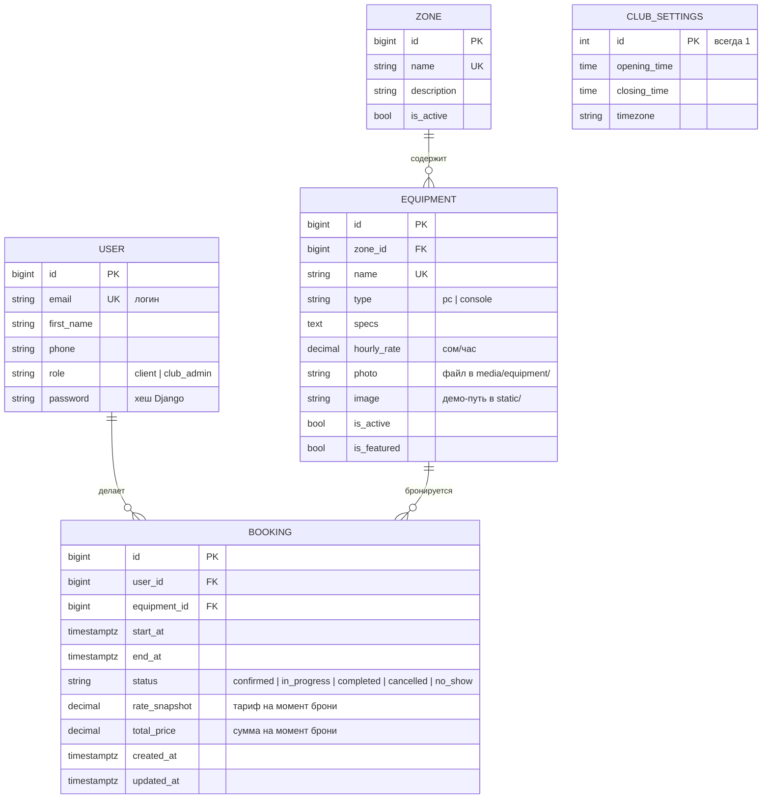

# ER-диаграмма GameTime

## Связи

- Один пользователь делает много броней. Удалить пользователя с бронями нельзя (`PROTECT`): история сохраняется.
- Зона содержит много единиц оборудования. Зону с оборудованием удалить нельзя.
- Единица оборудования бронируется много раз. Оборудование с бронями удалить нельзя, его выключают флагом `is_active`.
- `CLUB_SETTINGS` не связана с другими таблицами: единственная запись (id = 1) с часами работы клуба и его часовым поясом.

## Ограничения в базе

- `end_at > start_at` (CheckConstraint).
- `total_price >= 0` (CheckConstraint).
- Бронь одного устройства не пересекается с другой активной бронью: `ExclusionConstraint` на PostgreSQL (расширение `btree_gist`). Учитываются статусы `confirmed` и `in_progress`. Отменённые, завершённые и неявки время не занимают.
- `email` пользователя, `name` зоны и `name` оборудования уникальны.
- Индексы: `(equipment, start_at)`, `(user, start_at)`, `(type, is_active)`.

## Деньги и время

- Деньги хранятся как `Decimal`, валюта интерфейса — сом (KGS).
- Время хранится в UTC (`timestamptz`), показывается и считается в часовом поясе клуба.
- Тариф и сумма фиксируются в брони при создании, изменение каталога не меняет историю.
